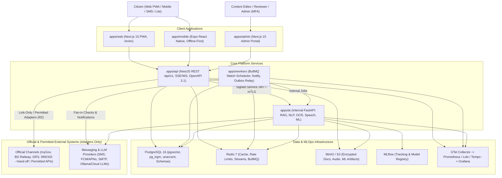

# ADR-0001: Jonoshheba AI Monorepo, Hexagonal Modules, Event Bus & AI Service Boundary

- **Status:** Accepted
- **Date:** 2026-11-19
- **Context:** Jonoshheba AI (জনসেবা AI) is an independent smart citizen-service discovery, guidance, notification, and tracking platform for Bangladesh operating strictly under Rules R1–R11 (`AGENTS.md`).

---

## 1. Architectural Decisions

### 1.1 Monorepo & Bounded Contexts
The repository uses `pnpm` workspaces + Turborepo with clear application boundaries (`apps/api`, `apps/ai`, `apps/workers`, `apps/web`, `apps/admin`, `apps/mobile`) and shared packages (`packages/shared`, `packages/config`, `packages/ui`, `packages/sdk`, `packages/eslint-config`, `packages/tsconfig`).

Within `apps/api`, each of the 12 product modules is organized as a hexagonal bounded context:
`controller → application service → domain → ports → adapters`

PostgreSQL uses schema-per-context (`identity`, `catalogue`, `transport`, `notify`, `cases`, `opportunities`, `ai`, `admin`, `audit`). Modules **never** query another module's tables directly.

### 1.2 Event Bus (Transactional Outbox + Redis Streams / BullMQ)
Cross-module communication uses domain events persisted atomically in `audit.outbox_events` inside the originating database transaction:
1. Module writes domain state + outbox event in one PostgreSQL transaction.
2. `apps/workers` relays unpublished outbox events onto Redis Streams / BullMQ queues (e.g., `watch.matched` → Notification module; `service.published` → AI RAG indexing queue).
3. Consumers are idempotent (`dedupe_key` unique constraints) and send exhausted failures to Dead-Letter Queues (DLQ).

### 1.3 Internal-Only AI Service Boundary (`apps/ai`)
`apps/ai` (Python 3.12 + FastAPI) encapsulates RAG, Bangla/English NLP, OCR, ASR/TTS, and ML inference/training (MLflow):
- **Network isolation:** `apps/ai` is never exposed directly to the public internet. Only `apps/api` and `apps/workers` call it using signed internal service JWTs (and mTLS in production).
- **Deterministic authority (Rule R7):** Eligibility decisions, hotline numbers, official fees, and deadlines come from deterministic PostgreSQL/rules-engine outputs in `apps/api`. `apps/ai` explains, cites, and drafts only.
- **Emergency short-circuit (Rule R8):** Immediate danger queries bypass LLM generation and immediately return verified tap-to-call hotline cards (`999`, `333`, etc.).

### 1.4 External Provider Adapter Isolation (Rules R2, R4, R6)
All external transport and official data integrations sit behind strict Port/Adapter contracts (`TransportProviderAdapter`, `SmsPort`, `ChannelPort`, `SearchPort`) tagged with an explicit `IntegrationType` (`OFFICIAL_API | PARTNER_FEED | PERMITTED_FEED | MANUAL | LINK_ONLY | MOCK`). Only the first three may be displayed as `"live"`. No scraping or CAPTCHA/rate-limit bypasses are permitted.

---

## 2. C4 Container Diagram

---

## 3. Consequences

- Clean bounded contexts allow independent scaling and future service extraction without rewriting domain code.
- Separating `apps/ai` in Python enables native Bangla NLP/OCR/ASR/ML tooling (`bge-m3`, `faster-whisper`, `LightGBM`, `MLflow`) while preserving strict TypeScript contracts across `apps/api`, `packages/sdk`, `apps/web`, `apps/admin`, and `apps/mobile`.
- Fail-fast config validation (`zod` in TypeScript, `pydantic-settings` in Python) prevents misconfigured boots across all environments.
