# Jonoshheba AI — Entity-Relationship Diagram (PostgreSQL 16 Multi-Schema)

All primary keys are RFC 9562 **UUIDv7** (`uuid(7)`). Timestamps are stored in UTC (`timestamptz`) and displayed in `Asia/Dhaka`. Cross-context references store UUIDs without tight cross-schema foreign keys so bounded contexts remain independently deployable and communicate via `audit.outbox_events`.

## Bounded-Context ERD

```mermaid
erDiagram
  %% === 1. IDENTITY SCHEMA ===
  USERS ||--o{ IDENTITY_PROVIDERS : "links"
  USERS ||--o{ SESSIONS : "holds"
  USERS ||--o{ USER_ROLES : "assigned"
  ROLES ||--o{ USER_ROLES : "grants"
  ORGANIZATIONS ||--o{ USER_ROLES : "scopes"
  USERS ||--o| USER_PREFERENCES : "configures"
  USERS ||--o| USER_PROFILE_HINTS : "consented hints"
  USERS ||--o{ CONSENTS : "records"
  USERS ||--o{ DEVICES : "registers"
  USERS ||--o{ DOCUMENTS : "owns (RLS)"

  USERS {
    uuid id PK
    string phone_e164 UK
    string email UK
    string status
    string locale
    boolean mfa_enabled
  }
  SESSIONS {
    uuid id PK
    uuid user_id FK
    string platform
    string refresh_token_hash UK
    uuid token_family_id
    timestamptz expires_at
  }
  OTP_CHALLENGES {
    uuid id PK
    string phone_e164
    string code_hash
    int attempts
    timestamptz expires_at
  }
  DOCUMENTS {
    uuid id PK
    uuid owner_id FK
    string object_key UK
    string malware_scan_status
    timestamptz retention_until
    string encrypted_dek
  }

  %% === 2. CATALOGUE SCHEMA (GEO + SERVICES + EMERGENCY) ===
  DIVISIONS ||--o{ DISTRICTS : "contains"
  DISTRICTS ||--o{ UPAZILAS : "contains"
  UPAZILAS ||--o{ UNIONS_WARDS : "contains"

  SERVICE_CATEGORIES ||--o{ SERVICE_CATEGORIES : "parent"
  SERVICE_CATEGORIES ||--o{ SERVICES : "classifies"
  AGENCIES ||--o{ SERVICES : "provides"
  SOURCES ||--o{ SERVICES : "verifies (R5)"
  SERVICES ||--o{ SERVICE_VERSIONS : "history"
  SERVICES ||--o{ SERVICE_REQUIREMENTS : "requires"
  SERVICES ||--o{ SERVICE_STEPS : "guides"
  SERVICES ||--o{ SERVICE_OFFICES : "located at"
  SERVICES ||--o{ FAQS : "answers"
  LIFE_EVENTS ||--o{ LIFE_EVENT_STEPS : "orders"
  SERVICES ||--o{ LIFE_EVENT_STEPS : "linked in"
  SOURCES ||--o{ NOTICES : "backs (NOT NULL)"
  SOURCES ||--o{ HOTLINES : "backs (2-person review)"
  SOURCES ||--o{ FACILITIES : "verifies"
  SOURCES ||--o{ UTILITY_OUTAGES : "verifies"

  SERVICES {
    uuid id PK
    string slug UK
    string title_bn
    string title_en
    string status
    string trust_label
    int version
    timestamptz last_verified_at
  }
  SOURCES {
    uuid id PK
    string url
    string agency
    string trust_label
    timestamptz valid_to
  }
  HOTLINES {
    uuid id PK
    string number UK
    string category
    boolean verify_before_release
    uuid verified_by
    uuid second_reviewer_id
  }

  %% === 3. TRANSPORT SCHEMA ===
  TRANSPORT_PROVIDERS ||--o{ ROUTES : "operates"
  TRANSPORT_PROVIDERS ||--o{ TRIPS : "schedules"
  TRANSPORT_PROVIDERS ||--o{ SEAT_CLASSES : "offers"
  TRANSPORT_PROVIDERS ||--o{ INVENTORY_SNAPSHOTS : "observed"
  STATIONS_STOPS ||--o{ ROUTES : "origin/dest"
  ROUTES ||--o{ TRIPS : "runs"
  STATIONS_STOPS ||--o{ TICKET_WATCHES : "origin/dest"
  TICKET_WATCHES ||--o{ WATCH_MATCHES : "matches"
  INVENTORY_SNAPSHOTS ||--o{ WATCH_MATCHES : "evidences"

  TRANSPORT_PROVIDERS {
    uuid id PK
    string code UK
    string mode
    string integration_type
    int rate_limit_per_min
  }
  TICKET_WATCHES {
    uuid id PK
    uuid user_id
    date journey_date
    string status
    timestamptz expires_at
  }
  INVENTORY_SNAPSHOTS {
    uuid id PK
    uuid provider_id FK
    string route_key
    string state
    int seats_available
  }
  DEMAND_AGGREGATES {
    uuid id PK
    string route_key
    date journey_date
    int watch_count
  }

  %% === 4. NOTIFY SCHEMA ===
  NOTIFICATIONS ||--o{ NOTIFICATION_FEEDBACK : "rated by"

  NOTIFICATION_TEMPLATES {
    uuid id PK
    string key
    string channel
    string locale
  }
  NOTIFICATION_JOBS {
    uuid id PK
    uuid user_id
    string channel
    string dedupe_key UK
    string priority
    string status
  }

  %% === 5. OPPORTUNITIES SCHEMA ===
  PROGRAMS {
    uuid id PK
    string slug UK
    string category
    string trust_label
    uuid source_id
  }
  SCHOLARSHIPS {
    uuid id PK
    string slug UK
    string education_level
    uuid source_id
  }
  JOB_CIRCULARS {
    uuid id PK
    string slug UK
    timestamptz deadline_at
    uuid source_id
  }
  ELIGIBILITY_RULES {
    uuid id PK
    string target_type
    uuid target_id
    int version
    jsonb rule_json_logic
    uuid source_id
  }

  %% === 6. CASES SCHEMA ===
  DUPLICATE_CLUSTERS ||--o{ CITIZEN_CASES : "groups"
  CITIZEN_CASES ||--o{ CASE_EVENTS : "logs"

  COMPLAINT_GUIDES {
    uuid id PK
    string slug UK
    string official_channel_url
    uuid source_id
  }
  CITIZEN_CASES {
    uuid id PK
    uuid user_id
    string case_type
    string status
    string external_reference
  }

  %% === 7. AI SCHEMA ===
  KB_DOCUMENTS ||--o{ KB_CHUNKS : "split into"
  CONVERSATIONS ||--o{ MESSAGES : "contains"
  MESSAGES ||--o{ MESSAGE_FEEDBACK : "rated"

  KB_CHUNKS {
    uuid id PK
    uuid document_id FK
    int ordinal
    vector embedding
    tsvector tsv
  }
  AI_EVAL_RUNS {
    uuid id PK
    string suite_name
    string prompt_version
    boolean passed
  }

  %% === 8 & 9. ADMIN & AUDIT SCHEMAS ===
  AUDIT_LOGS {
    uuid id PK
    uuid actor_id
    string action
    string resource_type
    timestamptz created_at
  }
  OUTBOX_EVENTS {
    uuid id PK
    string aggregate_type
    string event_type
    timestamptz published_at
  }
  FEATURE_FLAGS {
    uuid id PK
    string key UK
    boolean enabled
  }
```

## Schema Inventory (9 Bounded-Context Schemas)

| Schema | Tables | Special PostgreSQL Features |
|---|---|---|
| `identity` | `users`, `identity_providers`, `sessions`, `otp_challenges`, `roles`, `organizations`, `user_roles`, `user_preferences`, `consents`, `user_profile_hints`, `devices`, `documents` | RLS on 6 user-owned tables; partial index on active sessions |
| `catalogue` | `divisions`, `districts`, `upazilas`, `unions_wards`, `service_categories`, `life_events`, `life_event_steps`, `agencies`, `sources`, `services`, `service_versions`, `service_requirements`, `service_steps`, `service_offices`, `notices`, `faqs`, `content_reports`, `saved_items`, `reminders`, `hotlines`, `facilities`, `utility_outages` | `pg_trgm` GIN indexes on `services.title_bn/en`; RLS on `saved_items` & `reminders`; partial indexes on published services & notices |
| `transport` | `transport_providers`, `stations_stops`, `routes`, `trips`, `seat_classes`, `journey_searches`, `ticket_watches`, `inventory_snapshots`, `watch_matches`, `demand_aggregates` | `pg_trgm` GIN on `stations_stops.name_bn/en`; partial index on active `ticket_watches` by `journey_date`; RLS on `ticket_watches` & `journey_searches` |
| `notify` | `notification_templates`, `notifications`, `notification_jobs`, `notification_feedback` | Unique `dedupe_key`; RLS on `notifications`, `notification_jobs`, `notification_feedback` |
| `opportunities` | `programs`, `scholarships`, `job_circulars`, `eligibility_rules` | Versioned deterministic JSON-Logic eligibility rules |
| `cases` | `complaint_guides`, `duplicate_clusters`, `citizen_cases`, `case_events` | RLS on `citizen_cases` |
| `ai` | `kb_documents`, `kb_chunks`, `conversations`, `messages`, `message_feedback`, `ai_eval_runs`, `model_registry_refs`, `prompt_versions` | `pgvector` HNSW cosine index (`vector(1024)`), GIN `tsvector`, GIN `pg_trgm` on `kb_chunks`; RLS on `conversations` |
| `admin` | `feature_flags`, `provider_health_checks` | Ops telemetry & controlled rollouts |
| `audit` | `audit_logs`, `outbox_events`, `data_export_requests`, `deletion_requests` | Append-only trigger blocking `UPDATE`/`DELETE` on `audit_logs`; partial index on unpublished `outbox_events`; RLS on export/deletion requests |
